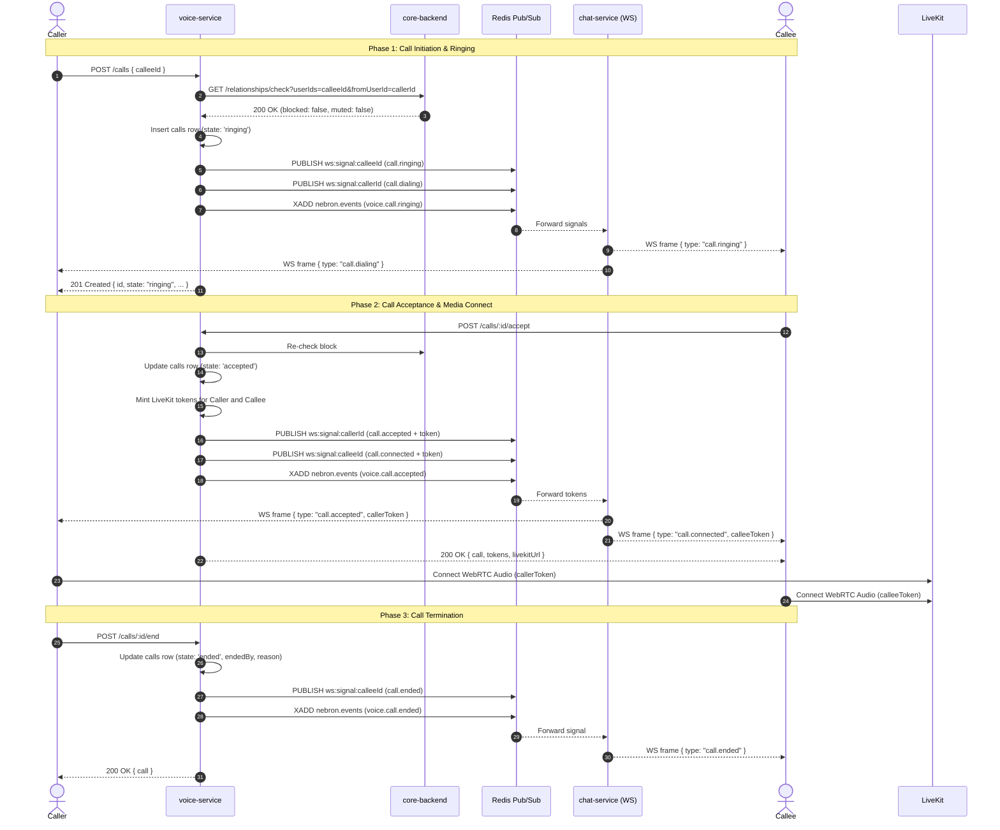

# 1:1 Voice Call End-to-End Lifecycle & Architecture

Complete architecture documentation for the Nebron 1:1 voice call control plane, covering state machine transitions, concurrency control, relationship checks, and background timeout processing.

---

## 1. High-Level Architecture

The voice call system is decomposed into four collaborating components:
1. **`voice-service` (Fastify + ScyllaDB + Redis)**: Exposes REST API control plane, enforces call state transitions, checks relationships, generates LiveKit access tokens, and publishes signaling events.
2. **`core-backend`**: Provides relationship status (`blocked`, `muted.calls`) via `GET /relationships/check`.
3. **`chat-service` (WebSocket Gateway)**: Subscribes to Redis `ws:signal:{userId}` channels and forwards push signaling frames to client WebSockets.
4. **LiveKit SFU Server**: Handles WebRTC media exchange, audio tracks, and room lifecycle.



---

## 2. Concurrency & Pre-Condition Rules

Before initiating or accepting a call:
- **Cannot call self**: `callerId === calleeId` returns `400 Bad Request` (`cannot_call_self`).
- **Block enforcement**: If caller blocked callee or callee blocked caller, returns `403 Forbidden` (`blocked`).
- **Mute enforcement**: If callee muted calls from caller, returns `403 Forbidden` (`muted`).
- **Active call concurrency**: Either party in an active call (`'ringing'` or `'accepted'`) results in `409 Conflict` (`already_in_call`).

---

## 3. Missed Call Timeout Sweep

If a call remains in `'ringing'` state longer than `CALL_RING_TIMEOUT_SECONDS` (default: 45 seconds):
- Background sweep job (`CallTimeoutJob`) polls ScyllaDB every 5 seconds.
- Uses ScyllaDB Lightweight Transactions (LWT) for atomic concurrency:
  ```cql
  UPDATE calls SET state = 'missed', ended_at = ?, end_reason = 'missed'
  WHERE id = ? IF state = 'ringing'
  ```
- If applied:
  - Publishes `call.missed` to `ws:signal:{callerId}` and `ws:signal:{calleeId}`.
  - Publishes `voice.call.missed` to Redis Stream `nebron.events`.
- If not applied (already answered, rejected, or cancelled), the update is skipped safely without race conditions.
